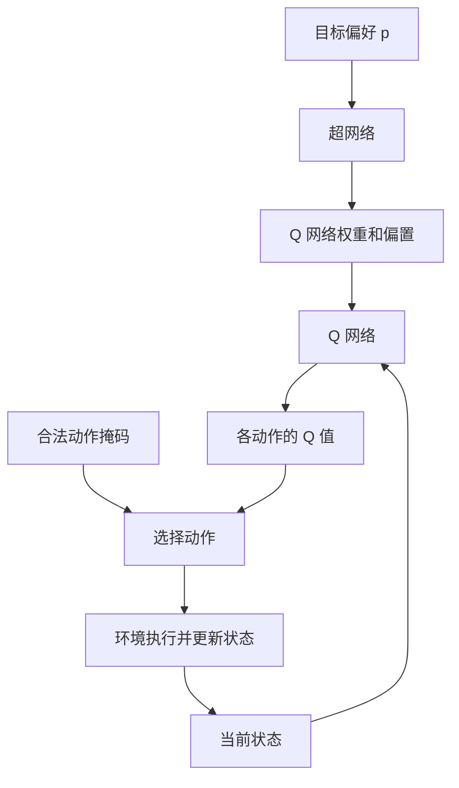
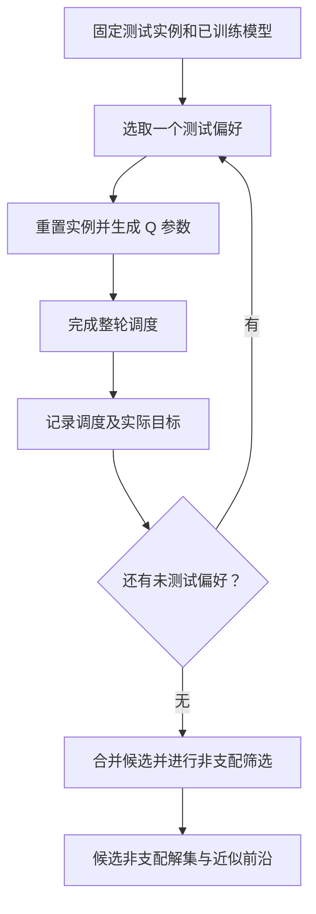

# 柔性作业车间调度、强化学习与超网络学习笔记

> 第一版 · 2026-10-20  
> 整理依据：此前相关讨论，以及 2026-10-11 保存的《超网络嵌入强化学习_调度流程图与公式.md》。这是按知识逻辑重组的学习笔记，不是完整聊天逐字稿。新补充的算例用于解释概念，不是实验结果。

本文按“调度问题 → 多目标优化 → 强化学习 → 超网络 → 训练 → 评价”的顺序展开。当前具体方案是 **超网络生成 DQN 参数**；它是待实现、待验证的方案，不代表已有论文完整实现了这里的车间调度算法，也不代表已证明优于其他算法。

## 1. 柔性作业车间调度究竟决定什么

柔性作业车间调度问题（FJSP）通常同时决定两件事：每道工序分配给哪台可加工机器，以及同一台机器上的工序按什么顺序加工。

一个工件可以包含多道工序。工件内部通常有固定的先后关系，但某道工序可能有多台可选机器，而且加工时间可能不同。因此，“选择最快的机器”不能保证整体最优：它可能造成某台机器拥堵，延误其他工件。

为了先把学习主线写清，下面采用静态、加工不可中断的基础设定；动态到达、故障、换型等约束需要后续另行加入。

| 符号 | 含义 |
|---|---|
| $I$ | 一个调度实例，包括工件、工序、机器与加工数据 |
| $O_{ij}$ | 工件 $i$ 的第 $j$ 道工序 |
| $\mathcal M_{ij}$ | 可以加工该工序的机器集合 |
| $t_{ijk}$ | 工序 $O_{ij}$ 在机器 $k$ 上的加工时长 |
| $S_{ij},C_{ij}$ | 工序的开始与完成时间 |
| $\sigma$ | 一份完整的调度方案 |
| $\Omega(I)$ | 实例 $I$ 的全部可行调度方案集合 |

若工序选择机器 $k$，则完成时间满足：

$$
C_{ij}=S_{ij}+t_{ijk}.
$$

同一工件的前序工序完成后，后序工序才能开始：

$$
S_{i,j+1}\ge C_{ij}.
$$

两道分配到同一机器的工序不能重叠，必须一前一后。每道工序只能选择一台属于其可加工集合的机器。这些约束共同决定 $\Omega(I)$。

这里列出的是理解环境所需的主要约束，不是完整的混合整数规划模型。

## 2. 多目标、支配关系与帕累托解集

此前以最大完工时间与总能耗作为两个目标示例：

$$
\min_{\sigma\in\Omega(I)}\mathbf F(\sigma;I)
=\min_{\sigma\in\Omega(I)}\big(C_{\max}(\sigma),E_{\mathrm{total}}(\sigma)\big).
$$

最大完工时间是最后一个工件完成的时刻：

$$
C_{\max}=\max_i C_i.
$$

能耗可用机器功率随时间的积分表示：

$$
E_{\mathrm{total}}=\sum_{k=1}^{M}\int_0^{C_{\max}}P_k(u;\sigma)\,du.
$$

加工、空闲、关闭时的功率，以及积分时间范围，都属于需要明确的建模选择。不能在未定义机器功率模型时直接声称已经准确计算能耗。

**支配关系**：所有目标都按越小越好处理。如果方案 A 在所有目标上都不比 B 差，且至少一个目标严格更好，就说 A 支配 B：

$$
\sigma^A\prec\sigma^B
\iff
\big[\forall i,F_i(\sigma^A)\le F_i(\sigma^B)\big]
\land
\big[\exists j,F_j(\sigma^A)<F_j(\sigma^B)\big].
$$

下面是本次补充的教学算例，时间和能耗的单位分别保持一致：

| 方案 | 最大完工时间 | 总能耗 | 在这三个候选中的关系 |
|---|---:|---:|---|
| A | 10 | 100 | 时间更短，但比 B 耗能更多 |
| B | 12 | 80 | 能耗更低，但比 A 用时更长 |
| C | 13 | 110 | 被 A 和 B 分别支配 |

A、B 互不支配；C 可以淘汰。但这只能说明 A、B 在当前候选集合中非支配，不能说明不存在尚未找到的更优方案。

需要区分三个对象：

1. **帕累托解集**：在全部可行解中不被其他解支配的调度方案集合。
2. **帕累托前沿**：这些调度方案对应的目标向量集合，例如时间—能耗平面上的点。
3. **候选非支配解集**：只在目前找到的候选方案之间筛选得到的集合，是实际算法常见的近似输出。

## 3. 偏好向量怎样表达取舍

设共有 $m$ 个目标，偏好向量满足：

$$
\mathbf p=(p_1,\ldots,p_m),\qquad p_i\ge0,\qquad\sum_i p_i=1.
$$

两个目标时，$\mathbf p=(0.8,0.2)$ 表示在所采用的加权目标中，更重视第一个目标；它不表示最终结果一定有“80%的时间优化、20%的能耗优化”。

不同目标的数值尺度可能相差很大。先使用固定参考尺度归一化：

$$
\widetilde F_i=\frac{F_i-\ell_i}{u_i-\ell_i},\qquad u_i>\ell_i.
$$

这里 $\ell_i,u_i$ 是预先约定的参考值，不要求知道精确最优值。训练和评价需要一致；超出区间时数值可以超过 $[0,1]$，不应随意裁剪。

本版主线使用加权和：

$$
A_{\mathrm{ws}}(\sigma\mid\mathbf p)=\sum_{i=1}^m p_i\widetilde F_i(\sigma).
$$

偏好改变，就相当于改变“怎样综合评价一份调度”的规则。线性加权和可能遗漏非凸前沿上的一些点，因此遍历许多偏好也不能保证覆盖完整前沿。

切比雪夫聚合是另一条可选路线：

$$
A_{\mathrm{tch}}(\sigma\mid\mathbf p)
=\max_i\{p_i|\widetilde F_i(\sigma)-z_i^*|\}.
$$

$z_i^*$ 是归一化目标空间的理想参考值。它与加权和是不同的聚合方式，不是必须依次执行的两个步骤。本版训练公式不混用这两种路线。

## 4. 怎样把调度写成强化学习问题

强化学习智能体每次只做一个调度决策；环境执行决策、更新机器与工序状态，多次决策最终形成完整调度。

| 强化学习概念 | 在当前调度设定中的含义 |
|---|---|
| 状态 $s_t$ | 工序进度、机器状态、当前时间、累计指标等 |
| 动作 $a_t$ | 例如选择一对“工序—机器” |
| 合法动作集合 $\mathcal A(s_t)$ | 当前满足前序、机器适配和资源约束的动作 |
| 奖励向量 $\mathbf r_t$ | 分别对应各目标的奖励分量 |
| 终止标志 $d_t$ | 全部加工任务是否真正完成 |
| 一轮 episode | 从初始实例到完整调度完成的过程 |

状态必须提供预测后续转移和回报所需的信息。只记录“还有多少道工序”通常不够，因为同样的数量可能对应完全不同的机器占用情况。

当前使用事件驱动环境：没有合法动作但仍有在加工任务时，推进到下一个完成事件，并结算等待期间的变化。若没有合法动作，也不存在未来事件，却仍有未完成工序，应检查不可行实例或环境错误。

这套基础动作空间采用“有合法加工动作时做派工”的设定。如果研究问题需要主动等待才能达到某些更优调度，就必须增加等待动作并重新定义推进规则，不能默认当前动作空间覆盖所有可行调度。

基础奖励采用容易核对的终局形式：

$$
r_{t,i}=\begin{cases}
0,&d_t=0,\\
-\widetilde F_i(\sigma),&d_t=1.
\end{cases}
$$

然后按偏好组合为标量奖励：

$$
r_t^{\mathbf p}=\mathbf p^\top\mathbf r_t.
$$

每轮固定偏好，在有限回合且 $\gamma=1$ 时：

$$
G_{\mathbf p}=\sum_{t=0}^{T-1}r_t^{\mathbf p}
=-\sum_i p_i\widetilde F_i(\sigma)
=-A_{\mathrm{ws}}(\sigma\mid\mathbf p).
$$

因此最大化累计奖励，恰好对应最小化加权调度代价。终局奖励可能稀疏、学习较慢，这是基线选择，不是唯一正确方案。若改变折扣因子或加入额外奖励，必须重新检查这个等式是否仍成立。

## 5. DQN 学习的是什么

Q 值估计：处在状态 $s$ 时先采取动作 $a$，之后继续决策，预计能获得多少累计奖励。

$$
Q^\pi(s,a;\mathbf p)=\mathbb E_\pi\left[
\sum_{u=t}^{T-1}\gamma^{u-t}r_u^{\mathbf p}
\mid s_t=s,a_t=a\right].
$$

当前方案输出标量 Q 值，即当前偏好下的综合价值。Q 值不是实际最大完工时间，也不是实际能耗。

训练交互时采用 $\varepsilon$ 贪心：以概率 $\varepsilon$ 从合法动作中随机探索，否则选择合法动作中 Q 值最大的动作。推理时可以关闭随机探索。

经验池保存：

$$
e_t=(s_t,a_t,\mathbf r_t,s_{t+1},d_t).
$$

保存奖励向量而不是只保存一个已加权的数，是为了之后用不同偏好重新组合奖励。还应保存或能正确重建下一状态的合法动作掩码。

## 6. 超网络插在哪里：先分清三类量

超网络的作用是生成另一个网络的参数。这里生成的是 Q 网络的权重和偏置：

$$
\theta_{\mathbf p}=g_\phi(\mathbf p),\qquad
Q_\phi(s,a;\mathbf p):=Q(s,a;g_\phi(\mathbf p)).
$$

| 量 | 含义 | 如何得到 |
|---|---|---|
| $\mathbf p$ | 目标偏好 | 训练时采样，测试时指定 |
| $\phi$ | 超网络自身参数 | 优化器训练更新 |
| $\theta_{\mathbf p}$ | 给定偏好下的 Q 网络参数 | 超网络前向计算生成 |

偏好决定当前要重视哪些目标；超网络据此生成一组 Q 网络参数；Q 网络再根据当前状态给动作评分。超网络本身并不直接输出完整调度。

**术语核对**：早先提问出现过“超网格”，目前找回的实现文档明确使用的是生成网络参数的 Hypernetwork，即“超网络”。本版按这个已确认的定义展开，暂不把“超网格”当作它的同义词；若原始材料另有定义，应单独补充。

## 7. 超网络究竟需要生成多少个参数

这一节是对此前重点疑问的展开。先确定被生成的 Q 网络结构，再数其中需要生成的权重和偏置，最后确定超网络输出维度。

对于带偏置的全连接层，上一层有 $n_{\ell-1}$ 个输入，当前层有 $n_\ell$ 个神经元：

$$
W^{(\ell)}\in\mathbb R^{n_\ell\times n_{\ell-1}},\qquad
b^{(\ell)}\in\mathbb R^{n_\ell}.
$$

每个神经元都要接收上一层全部输入，所以权重数是 $n_\ell n_{\ell-1}$；每个神经元还需要一个偏置，所以偏置数是 $n_\ell$。全网络相加：

$$
N_\theta=\sum_{\ell=1}^{L}\left(n_\ell n_{\ell-1}+n_\ell\right).
$$

**本次补充的教学结构**：假设 Q 网络输入维度为 6，两层隐藏层分别为 8 和 4，输出对应 3 个候选动作。

| 层 | 权重形状 | 权重个数 | 偏置个数 | 合计 |
|---|---|---:|---:|---:|
| 输入到隐藏层 1 | $8\times6$ | 48 | 8 | 56 |
| 隐藏层 1 到隐藏层 2 | $4\times8$ | 32 | 4 | 36 |
| 隐藏层 2 到输出层 | $3\times4$ | 12 | 3 | 15 |
| 总计 | — | 92 | 15 | **107** |

因此，若生成全部参数，超网络每次输出一个长度为 107 的向量：

$$
g_\phi(\mathbf p)\in\mathbb R^{107}.
$$

假设使用从 0 开始的索引和左闭右开切片，装配顺序可以约定为：

| 切片 | 装配结果 |
|---|---|
| $[0:48]$ | 第一层权重，重塑为 $8\times6$ |
| $[48:56]$ | 第一层偏置，长度 8 |
| $[56:88]$ | 第二层权重，重塑为 $4\times8$ |
| $[88:92]$ | 第二层偏置，长度 4 |
| $[92:104]$ | 输出层权重，重塑为 $3\times4$ |
| $[104:107]$ | 输出层偏置，长度 3 |

这里有三个不同的数量：两个优化目标意味着偏好输入是二维；三个候选动作意味着 Q 网络输出是三维；Q 网络有 107 个参数意味着超网络输出是 107 维。三者没有必须相等的关系。

107 也不是超网络自身参数 $\phi$ 的个数。假设超网络采用“2 维输入、16 维隐藏层、107 维输出”，且两层均有偏置，则其自身参数数为：

$$
N_\phi=(16\times2+16)+(107\times16+107)=1867.
$$

这说明“生成一个较小网络”不等于“生成器本身参数更少”。是否节省总成本，应与为多个偏好分别训练、保存模型的方案比较。

本算例只演示固定维度全连接网络。真实调度实例的工序、机器和动作数量可能变化，需要另行设计固定候选槽位、掩码或可变规模编码，不能把这里的 3 个动作直接当作最终实现。

## 8. 一次训练更新怎样完成

维护在线超网络 $g_\phi$ 与目标超网络 $g_{\phi^-}$。上标负号表示目标副本，不是取负数。

从经验池抽取一条经验，并采样训练偏好 $\mathbf p$。同一个训练项的当前预测、奖励、下一状态估计必须使用相同偏好。

第一步：生成在线与目标 Q 参数：

$$
\theta_{\mathbf p}=g_\phi(\mathbf p),\qquad
\theta^-_{\mathbf p}=g_{\phi^-}(\mathbf p).
$$

第二步：计算当前动作的预测值，并重组奖励：

$$
q=Q(s,a;\theta_{\mathbf p}),\qquad r^{\mathbf p}=\mathbf p^\top\mathbf r.
$$

第三步：计算普通 DQN 的 TD 目标：

$$
y=\begin{cases}
r^{\mathbf p},&d=1,\\
r^{\mathbf p}+\gamma\max_{a'\in\mathcal A(s')}Q(s',a';\theta^-_{\mathbf p}),&d=0.
\end{cases}
$$

终止后没有未来回报，因此不计算下一状态动作最大值。非终止状态要先由环境确保存在合法动作，不能对空集合求最大值。

第四步：把 $y$ 当作固定训练参照，计算误差并更新在线超网络：

$$
L=(q-\operatorname{stopgrad}(y))^2,\qquad
\phi\leftarrow\phi-\eta\nabla_\phi L.
$$

梯度通过生成参数回传：

$$
\frac{\partial L}{\partial\phi_j}
=2(q-y)\sum_v\frac{\partial Q(s,a;\theta_{\mathbf p})}{\partial\theta_{\mathbf p,v}}
\frac{\partial g_\phi(\mathbf p)_v}{\partial\phi_j}.
$$

这条链是“TD 损失 → 在线 Q 值 → 生成参数 → 超网络自身参数”。环境执行、离散动作选择、最终非支配筛选不在这条求导链中。实现时必须保留生成参数到 Q 输出的计算图。

第五步：每经过约定数量的在线更新，复制目标参数：

$$
\phi^-\leftarrow\phi.
$$

复制的是超网络自身参数；同步后，同一偏好才会在两条分支生成一致的 Q 参数。

若抽取 $B$ 条经验、配对 $K$ 个偏好，就得到 $BK$ 个训练项，使用这些误差平方的平均值作为批次损失。经验跨偏好复用要求环境转移和基础奖励分量不随偏好本身改变；如果偏好改变了环境机制，就不能直接这样复用。

## 9. 训练完怎样得到一组调度方案

固定训练后的超网络以及同一个测试实例，依次选择不同偏好。每个偏好都从该实例的初始状态开始，生成参数并完成一整轮调度。

例如两个目标时测试 $(0,1),(0.1,0.9),\ldots,(1,0)$。不同偏好可能产生同一调度，也可能出现互相支配的结果。

设候选集合为 $\mathcal C_I$，保留：

$$
\widehat S_I=\{\sigma\in\mathcal C_I:\nexists\sigma'\in\mathcal C_I,\ \sigma'\prec\sigma\}.
$$

对应的近似前沿是：

$$
\widehat{PF}_I=\{\mathbf F(\sigma;I):\sigma\in\widehat S_I\}.
$$

这里评价的是完整调度的实际指标。TD 损失下降、Q 值上升都不能代替最终调度评价；不同实例的候选解也不应直接混在一起做支配筛选。

## 10. 当前方案的边界与后续工作

| 内容 | 当前状态 |
|---|---|
| FJSP、支配关系、偏好、Q 值、超网络参数生成 | 已整理基础概念 |
| 每轮固定偏好、终局奖励、标量 Q、目标超网络 | 此前整理选定的具体实现路线 |
| 参数数量与切片算例 | 本次补充的教学例子 |
| 状态编码、可变动作规模、具体能耗数据 | 仍需定义和实现 |
| 奖励稠密化、偏好采样、部分参数生成等 | 可探索方向，尚非经验证的创新结论 |
| 训练效果、跨规模泛化、与其他方法的比较 | 尚无本笔记对应的实验结果 |

后续可以按下面的顺序补齐笔记与实现，完成一项再勾选：

- [ ] 给出一个包含工件、工序、可选机器、加工时间的完整小实例。
- [ ] 手算一份可行调度和实际目标，作为环境输出的核对依据。
- [ ] 明确环境是否允许主动等待、何时推进物理时间、何时终止。
- [ ] 定义状态编码和合法动作编号。
- [ ] 先运行固定偏好的普通 DQN 基线，检查奖励与目标是否一致。
- [ ] 接入超网络，验证生成参数的数量、形状和梯度路径。
- [ ] 测试多个偏好，记录实际指标、去重和非支配筛选。
- [ ] 记录训练预算、随机种子、测试实例和失败情况，再讨论改进。

这些是后续实施顺序，不表示上述实验已经完成。特别是“超网络 + 强化学习 + 调度”这一组合本身不能直接作为原创性证明，具体创新需要结合相关研究与对照实验判断。

## 11. 自检：能否用自己的话回答

1. 为什么一台机器加工更快，不代表把工序都交给它就能得到最短总工期？
2. 帕累托解集中的元素与帕累托前沿中的元素有什么不同？
3. 为什么不能仅根据两个目标的原始数值大小来设置偏好？
4. $\mathbf p$、$\phi$、$\theta_{\mathbf p}$ 分别是什么？哪个被优化器更新？
5. 为什么两个目标的超网络可以输出 107 个数？
6. 为什么经验池应保留奖励向量，而不只保留已加权奖励？
7. 为什么终止状态不再计算下一状态最大 Q 值？
8. 为什么训练时不用对真实车间环境求导？
9. 为什么多个偏好生成的调度仍然需要非支配筛选？
10. 为什么 TD 损失降低不能单独证明调度算法更好？

## 12. 整理依据与延伸阅读

- 既有笔记：《超网络嵌入强化学习_调度流程图与公式.md》，2026-10-11。包含原有五张流程图及 F01—F35 公式。本版沿用其实现主线，按概念重新组织，不沿用原公式编号。
- Navon, A., Shamsian, A., Chechik, G., & Fetaya, E. *Learning the Pareto Front with Hypernetworks*. ICLR 2021. [论文页面](https://arxiv.org/abs/2010.04104)。用于理解偏好条件下生成任务网络参数的背景，不将其直接视为本笔记的 FJSP 实现。
- Mnih, V., et al. *Human-level control through deep reinforcement learning*. Nature, 2015. [DOI 链接](https://doi.org/10.1038/nature14236)。既有笔记列出的 DQN 背景文献。

本版尚未补齐 DQN、DDQN、DDPG、A2C、PPO 的独立系统章节，也未收录全部历史讨论或实验代码；这些内容应在核对相应旧资料后继续整理。
