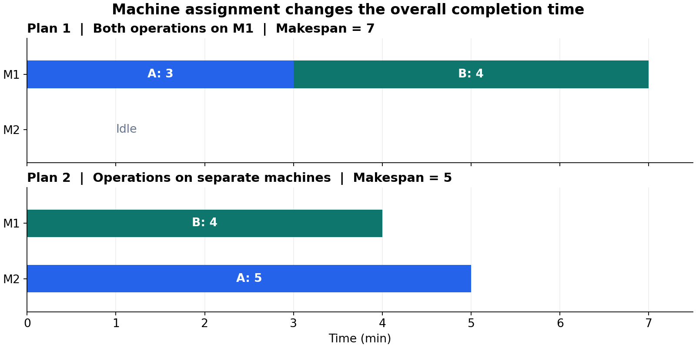

# 柔性车间调度：机器选择与工序顺序

> 2026-10-21｜学习重点：局部加工时间与整体完工时间的区别。图中数据为教学示例。

## 1. 为什么最快的机器不一定产生最短工期？

假设 A、B 是两个独立工件的单道工序，均在时刻 0 就绪；M1、M2 均空闲。

| 工序 | M1 加工时间 | M2 加工时间 |
|---|---:|---:|
| A | 3 min | 5 min |
| B | 4 min | 不可加工 |

**图示理解：** 上图将两道工序都交给 M1，耗时 7；下图让两台机器并行，耗时 5。A 的加工时间增加，整体工期却缩短。

$$
C_{\max}=\max_i C_i,\qquad
C_{\max}^{(1)}=3+4=7,\quad C_{\max}^{(2)}=\max(5,4)=5
$$

$C_i$ 为工件完成时间。调度优化的是所有工件的整体完成情况，不能只比较某道工序的加工时间。

## 2. 机器分配之后，还需要满足什么条件？

对工件 $i$ 的第 $j$ 道工序，设开始时间为 $S_{ij}$，在所选机器 $k$ 上加工时长为 $t_{ijk}$：

$$
C_{ij}=S_{ij}+t_{ijk},\qquad S_{i,j+1}\ge C_{ij}
$$

| 约束 | 含义 | 代码阅读中的对应点 |
|---|---|---|
| 加工资格 | 机器必须能加工该工序 | 工序—机器邻接关系 |
| 工序先后 | 后序不能早于前序完成 | 当前待调度工序、作业忙碌掩码 |
| 机器占用 | 同一机器上的加工不能重叠 | 机器忙碌掩码 |
| 不可中断 | 一道工序开始后连续完成 | 环境记录开始、结束时间 |

上传项目通过合法动作筛选和事件推进处理这些限制。暂时无合法动作时推进时间；它没有显式的“主动等待”决策动作。

**本次理解：** 先判断安排可行，再比较完工时间。  
**下一步核对：** 用包含前后工序的小实例检查 `env/fjsp_env.py` 的 `step` 与 `validate_gantt`，本次尚未运行环境。
