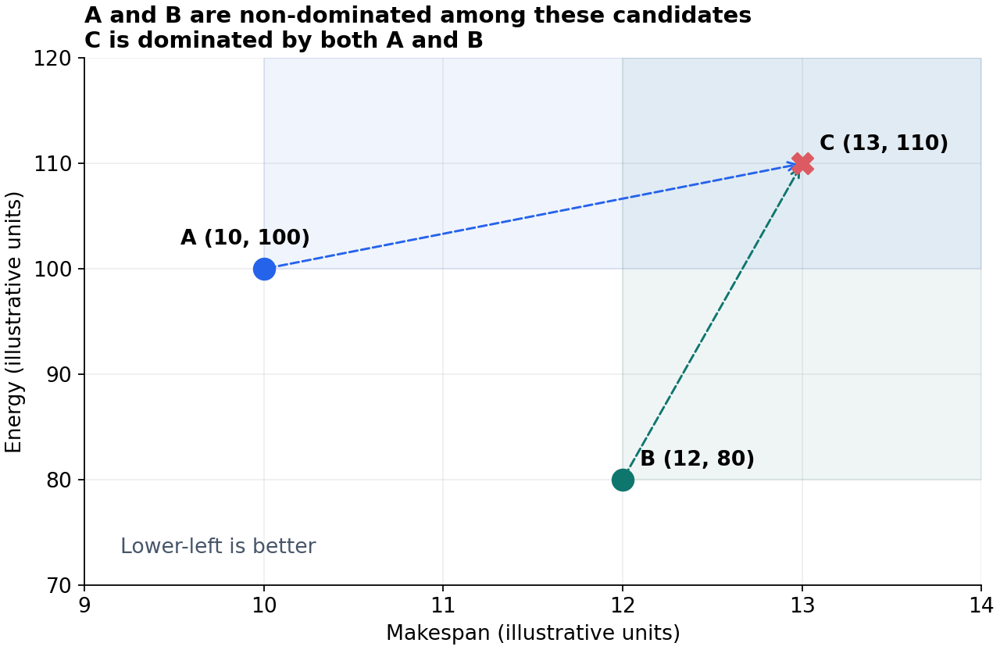

# 多目标取舍：支配关系、解集与偏好

> 2026-10-21｜学习重点：怎样保留不同取舍。上传项目目前优化完工时间，能耗与多目标属于扩展设想。

## 1. 哪些方案可以直接排除？

以完工时间和能耗为两个最小化目标：

**图示理解：** 横轴为完工时间，纵轴为能耗，左下方向更优。虚线箭头表示 A、B 分别支配 C；浅色区域表示不优于相应点的范围，不是已求出的真实前沿。数据为教学示例。

$$
A\prec C
\iff
\big[\forall i,\ F_i(A)\le F_i(C)\big]
\land
\big[\exists j,\ F_j(A)<F_j(C)\big]
$$

A=(10,100)，B=(12,80)，C=(13,110)。A 与 B 各有优势；C 在两项上都更差。A、B 只是这三个候选中的非支配解，尚不能称为全局最优解。

## 2. 解集、前沿与偏好分别表示什么？

| 概念 | 记录的内容 |
|---|---|
| 调度解集 | 工序分配、开始时间、加工顺序 |
| 目标前沿 | 上述安排对应的完工时间、能耗等坐标 |
| 偏好 $p$ | 当前评价中各目标的重要程度 |

采用线性加权时：

$$
J_p(\sigma)=p_1\widetilde C_{\max}(\sigma)+p_2\widetilde E(\sigma),
\qquad p_1,p_2\ge0,\quad p_1+p_2=1
$$

$\sigma$ 为调度方案；波浪号表示按固定参考尺度处理后的指标。$(0.8,0.2)$ 是评价权重，不表示实际改善比例。

**容易混淆：** 多取几个偏好，不保证产生不同方案，也不保证覆盖完整前沿；线性加权可能遗漏非凸部分。

**当前进度：** 已整理概念与示例。能耗模型、尺度选择及偏好输入尚未在上传代码中实现，需要先定义再训练。
