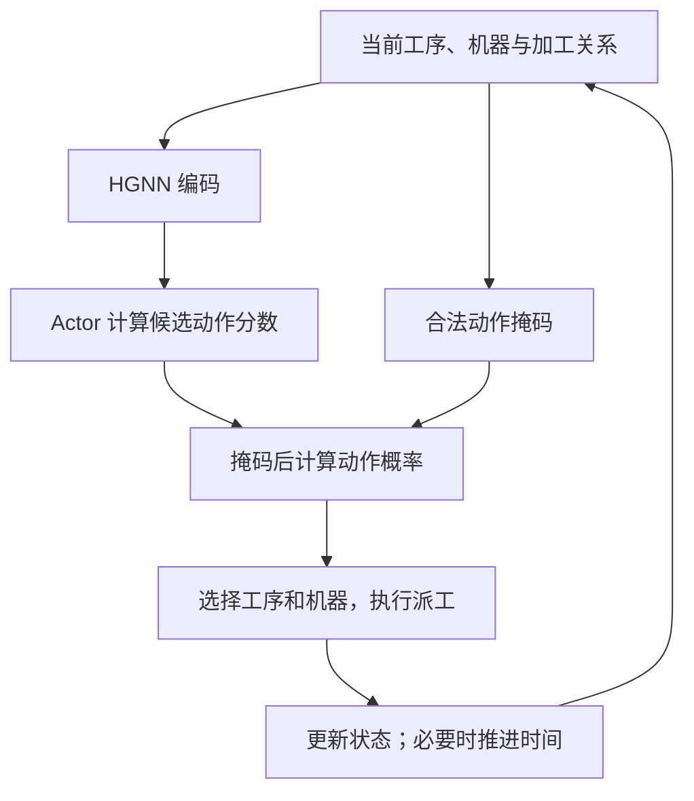

# 调度环境：状态、动作与增量奖励

> 2026-10-21｜依据上传项目静态阅读：`env/fjsp_env.py`、`PPO_model.py`。本次未运行训练。

## 1. 网络依据哪些信息选择动作？

| 状态组成 | 上传代码中的内容 |
|---|---|
| 工序特征：6 维 | 调度状态、相邻机器数、加工时长、作业剩余未调度工序数、作业完成时间估计、开始时间 |
| 机器特征：3 维 | 相邻工序数、可用时间、利用率 |
| 图关系 | 工序—机器关系、工序前驱与后继关系 |
| 动态掩码 | 作业是否忙碌或已分配完、机器是否忙碌 |

未调度工序的时间包含估计值，不能把中途所有特征都当作最终实测结果。

## 2. 一个动作如何从多个候选中产生？

代码先取每个工件当前待调度工序，再与机器组合。Actor 对每个候选计算一个分数 $z_a$，对非法动作屏蔽：

$$
\pi_\theta(a\mid s)=
\begin{cases}
\dfrac{\exp(z_a)}{\sum_{b\in\mathcal A(s)}\exp(z_b)},&a\in\mathcal A(s),\\
0,&a\notin\mathcal A(s).
\end{cases}
$$

$\mathcal A(s)$ 为合法动作集合。训练按概率采样；贪心测试选择概率最大动作。代码返回工序、机器、工件三个索引，表达的是同一次派工。

## 3. 上传项目的奖励是否只在最后给出？

不是。`step` 使用派工前后的最大完工时间估计差：

$$
r_t=\widehat C_{\max}(s_t)-\widehat C_{\max}(s_{t+1}),
\qquad
\sum_{t=0}^{T-1}r_t=\widehat C_{\max}(s_0)-C_{\max}(\sigma)
$$

第二个等式要求最终估计等于生成安排的实际完工时间；累计采用当前配置的 $\gamma=1$。对同一实例，初始项固定，因此回报越大对应最终工期越短。该关系描述原始奖励；PPO 更新前还会对回报进行标准化。

**终止细节：** 代码在全部工序已派工时结束决策，最后工序的结束时间已记录，可据此计算工期；这不等于环境时钟已推进到最后加工完成。未来加入能耗时，需要额外核对末段能耗结算。

**进度：** 已定位状态、掩码和奖励计算；下一步用小实例检查估计值如何随派工变化。
