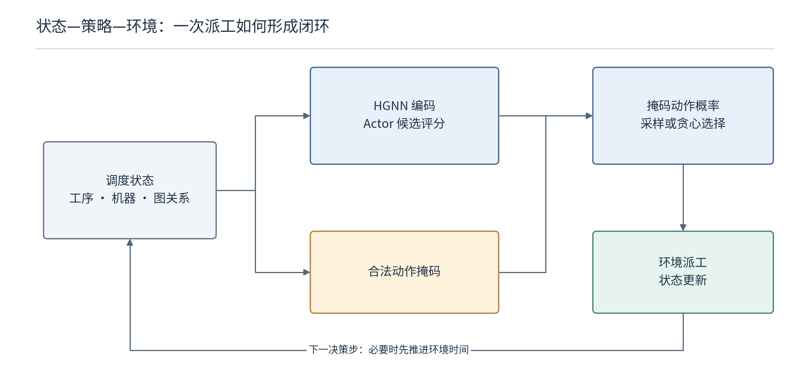

# 代码阅读（一）：一份实例怎样变成一次合法派工

> 实例行解析成矩阵，矩阵与动态特征组成状态，HGNN 和 Actor 为当前候选评分，动作索引再还原为派工记录。本篇用同一个小实例追踪这条数据链；训练更新放在下一篇。

## 1. 实例格式决定了张量的物理含义

解析器决定张量的物理含义。若把文件头当成工序，或把不可加工位置当成零时长合法动作，后续计算即使形状正常，含义也已经出错。

### 1.1 从三行文件手工还原矩阵

```text
2 2 1.5
1 2 1 3 2 5
1 1 1 4
```

| 行 | 解读 |
|---|---|
| 文件头 | 两个工件、两台机器，平均每道工序有一点五台合格机器 |
| 工件一 | 一道工序 A；两台可选机器：M1 耗时三，M2 耗时五 |
| 工件二 | 一道工序 B；一台可选机器：M1 耗时四 |

每一条工件行是长度可变的任务说明；先读工序数，再按每道工序的机器数量继续读对应的机器—时间对。不能按固定列数切割所有行。

正确解析后，忽略批次维度应得到

$$
P=\begin{bmatrix}3&5\\4&0\end{bmatrix},\qquad
A_{OM}=\begin{bmatrix}1&1\\1&0\end{bmatrix}.
$$

$`P_{ok}`$ 记录工序在机器上的加工时长，$`A_{OM}`$ 记录资格。行对应 A、B，列对应 M1、M2。文件机器编号从一开始，代码内部减一。

矩阵中的零表示没有可加工关系。标准化后的边特征即使出现零，也不意味着资格消失；合法性应依据邻接矩阵，而不是重新用标准化后的数值判断。

### 1.2 当前源码版本为什么会在这里报错？

`nums_detec` 以第一行为文件头，从后面的行统计工序。当前版本中，`load_fjs` 的两次扫描却都只跳过空行，没有排除文件头；`edge_detec` 又逐项执行整数转换。

文件头最后一项由生成器中的除法得到，可能写为 `1.5` 或 `3.0`。把它作为工件行解析，便可能出现整数转换或索引错误。前次从原始函数提取的隔离检查得到：

```text
ValueError: invalid literal for int() with base 10: '1.5'
```

报错来自解析逻辑：文件头被送进了处理工序数量与机器编号的整数语法，并非神经网络不支持小数。

隔离检查使用 NumPy 数组承接简单矩阵操作，没有运行完整 PyTorch 环境。复现前应统一两轮扫描的工件数据入口，核对工序数量、偏移与邻接关系；直接忽略小数字符串会让解析位置进一步错乱。

## 2. 状态为什么同时保存“实际时间”和“估计时间”？

### 2.1 只保存已派工工序，网络会缺少未来任务的信息

未派工部分也需要提供进度信息。调度开始时，多数工序尚未确定机器和开始时刻；若全部填零，网络难以区分加工链很长与即将完成的工件。源码因此沿工件先后关系计算加工时长及时间估计。

对未派工工序，平均加工时长为

$$
\bar p_o=\frac{\sum_{k\in\mathcal M_o}p_{ok}}{|\mathcal M_o|}.
$$

$`\mathcal M_o`$ 是该工序的合格机器集合。尚未选机器时，先填一份粗略工期预算；选定后，再把预算替换为实际预约时长。

A 的平均时长为 $`(3+5)/2=4`$，B 为四。两者都只有一道工序，所以初始开始时间均为零，估计完成时间均为四，初始估计工期为四。

这个预算没有完整考虑机器排队；平均机器耗时也可能高于最快机器耗时。因此它不是已经实现的时间，也不能不加证明就称为严格下界。

### 2.2 六个工序通道怎样对应到这个实例？

| 通道 | 含义 | A 初值 | B 初值 |
|---|---|---:|---:|
| 0 | 是否已派工 | 0 | 0 |
| 1 | 当前相邻机器数 | 2 | 1 |
| 2 | 估计／已选加工时长 | 4 | 4 |
| 3 | 工件剩余未派工工序数 | 1 | 1 |
| 4 | 工件估计／记录完成时间 | 4 | 4 |
| 5 | 工序估计／记录开始时间 | 0 | 0 |

机器特征按“相邻工序数、可用时间、利用率特征”排列，因此 M1 初值为 $`(2,0,0)`$，M2 为 $`(1,0,0)`$。这些数字是按源码设计手工推演的初态，不是完整环境运行日志。

单实例工序特征存为 $`6\times N`$，机器特征为 $`3\times m`$；加入批次后为 $`B\times6\times N`$ 和 $`B\times3\times m`$。策略读取时将特征维转到最后，成为 $`B_a\times N\times6`$ 和 $`B_a\times m\times3`$，$`B_a`$ 为当前活动环境数。

`EnvState` 是策略读取状态的接口；修改状态、记时间和给奖励的是 `FJSPEnv`。前者是交给决策者的状态清单，后者负责维护实际预约表。

## 3. 为什么只从每个工件拿出当前工序？

当前实现先用 `ope_step_batch` 提取各工件的待派工工序，再与机器组合，避免将所有后序工序都列为候选。作业忙碌掩码进一步排除前序仍在加工的工件。

合法性由三类条件取交集：

```python
# 按源码整理的逻辑摘记，省略批次扩展和形状变换
eligible = job_eligible & ma_eligible & (eligible_proc == 1)
scores[~mask] = float('-inf')
action_probs = softmax(scores)
```

当前工序指针先从每个工件的加工链中拿出下一张任务卡，掩码再检查“工件准备好了、机器空闲、设备合格”三枚许可。

### 3.1 一张候选卡片怎样变成展平位置？

HGNN 输出八维节点表示后，局部工序、局部机器、全局工序均值、全局机器均值拼为三十二维。形状变化为：

| 阶段 | 形状 | 每一维是什么 |
|---|---|---|
| 候选特征组装 | $`B_a\times n\times m\times32`$ | 环境、工件、机器、信息卡片 |
| 转置后评分布局 | $`B_a\times m\times n\times32`$ | 机器维先于工件维 |
| 标量评分展平 | $`B_a\times(mn)`$ | 每个候选一个分数 |

因此展平索引 $`a`$ 的还原关系为

$$
k=\lfloor a/n\rfloor,\qquad i=a\bmod n,\qquad
o=\mathrm{ope\_step}[i].
$$

$`k,i,o`$ 分别为零起始的机器、工件、工序索引。展平索引记录候选在列表中的位置，还原时必须遵循原来的机器行与工件列顺序。

**小实例逐项列出：** 两工件、两机器的顺序是 A—M1、B—M1、A—M2、B—M2，索引分别为零、一、二、三。最后一项不可行。若选择索引二，就得到工序零、机器一、工件零，即把 A 派给 M2。

`act` 返回 `[opes, mas, jobs]`，形状为 $`3\times B_a`$。三个编号描述同一次派工。若误以为展平顺序是工件优先，索引还原就可能把合法评分位置解释成另一项派工。

候选数量随工件和机器数量变化；候选特征维度仍为三十二。合法性掩码必须使用与评分完全相同的转置和展平顺序。

## 4. `step` 怎样把 A—M2 写入状态？



### 4.1 删除未选连接，是在记录已经确定的分配

对 A 只保留 M2 的连接；其余机器上的备选加工时长也按邻接矩阵置零：

$$
A_{OM}'=\begin{bmatrix}0&1\\1&0\end{bmatrix},\qquad
P'=\begin{bmatrix}0&5\\4&0\end{bmatrix}.
$$

备选预约单已经变成正式预约，状态图随之记录“这道任务实际交给谁”。A 的机器数由二变一，加工时长由平均四变为已选五。

随后记录开始时刻零、结束时刻五，将 A 标为已派工，其工件剩余未派工数减到零；M2 变忙，可用时间记为五。初始估计工期四变为五，所以奖励为

$$
r_0=4-5=-1.
$$

负号表示工期估计相对初态增加一个单位，不意味着这次派工必然比其他选择差。两次不同完整安排还需要比较后续累计回报。

当前状态里的加工时间矩阵会随派工删除备选值。若以后某个新特征需要查询原始全部机器时长，应保留明确的原始数据，不能默认动态矩阵仍含全部备选信息。

### 4.2 为什么派出 A 后，时钟还不前进？

B 仍可以立即使用 M1，所以 `if_no_eligible` 判断当前仍有合法组合。接着派出 B，开始时刻同样为零，结束时刻为四；最大工期仍是五，第二次奖励为零。

| 决策后 | 已记录安排 | 环境时钟 | 工期估计 | 奖励 |
|---|---|---:|---:|---:|
| 初态 | 尚未派工 | 0 | 4 | — |
| A—M2 | A 在 $`[0,5)`$ | 0 | 5 | -1 |
| B—M1 | 再加入 B 在 $`[0,4)`$ | 0 | 5 | 0 |

累计奖励为 $`-1=4-5`$。这份手算把状态、派工时间、工期与奖励对应到了同一安排。

如果还有未派工工序且没有合法组合，`next_time` 才将相应实例的时钟推进到最近相关机器释放时刻，释放机器和对应工件的忙碌掩码，再检查能否派工。

### 4.3 `done` 为什么可以在时钟仍为零时出现？

本例第二次派工后，所有工序都已经分配，程序可以终止决策，虽然两台机器的加工还要持续到时刻四和五。代码已经保存这些结束时间，所以能够报告工期五。

排班员已经填完全部预约表，可以停止作出新决定；车间仍会按照预约表继续生产。

“已派工完成”与“加工全部结束”不同。以后按生产时间累计能耗时，需要把最后派工后直到最终加工结束的尾段也结算进去。

## 5. 这条数据链最值得保留的检查点是什么？

这条数据链需要从解析矩阵一路核对到奖励：先检查原始特征，再检查候选与掩码顺序，随后检查派工记录和时间推进。仅看 Actor 是否输出概率，无法确认整条链的物理含义正确。

版本与进度： 对应本次阅读的源码压缩包，SHA-256 为 `281236e2350a8f50e649b611561f1c3db04b0506a5043dcc85f57a2daf2868de`。已静态核对并完成前次解析函数隔离检查，完整环境与训练尚未运行。本篇没有修改源项目。

源码锚点： `env/load_data.py::{nums_detec,load_fjs,edge_detec}`；`env/fjsp_env.py::{__init__,step,if_no_eligible,next_time}`；`PPO_model.py::{get_action_prob,act}`。
