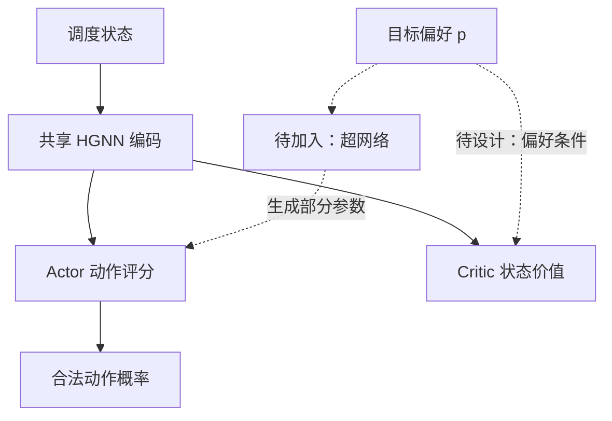

# 超网络：参数生成位置与数量

> 2026-10-21｜区分通用概念、代码现状与待验证方案。上传项目中的 HGNN 是异构图神经网络，不是 Hypernetwork。

## 1. 超网络可以接入哪里？

此前讨论的是生成 DQN 的 Q 参数。若基于这次上传的 PPO 项目继续探索，可以考虑生成 Actor 的部分参数；下面是新设想，代码尚未实现。

$$
\theta_p=g_\phi(p),\qquad
N_\theta=\sum_{\ell=1}^{L}\left(n_{\ell-1}n_\ell+n_\ell\right)
$$

$p$ 是偏好；$\phi$ 是超网络自身参数；$\theta_p$ 是生成参数。参数计数式适用于带偏置的全连接层，不包含未列出的图编码器或其他模块。

## 2. 生成参数数量怎样对应到具体网络？

| 对象 | 层维度 | 权重与偏置总数 |
|---|---|---:|
| 之前的教学网络 | 6→8→4→3 | $(48+8)+(32+4)+(12+3)=107$ |
| 上传配置的 Actor MLP | 32→64→64→1 | $(2048+64)+(4096+64)+(64+1)=6337$ |
| 仅 Actor 最后一层 | 64→1 | $64+1=65$ |

代码中每类节点嵌入为 8 维，Actor 拼接四组特征，得到 32 维输入。配置中的 `n_hidden_actor=3` 在 `MLPActor` 中表示三个线性层，包含输出层。

**输出为 1 并非只有一个动作：** 同一个 MLP 对每个候选工序—机器对分别输出一个分数，再共同计算概率。因此，候选数量变化不等于每次都要改变 Actor 参数数量。

## 3. 只生成最后一层，需要补充哪些设计？

| 部分 | 初步处理 |
|---|---|
| HGNN 与 Actor 前层 | 保持共享表示；是否联合训练需明确 |
| Actor 最后一层 | 尝试由偏好生成 65 个参数 |
| Critic | 回报随偏好变化，应考虑接收偏好 |
| 奖励 | 先实现目标分量、尺度与组合方式 |
| PPO 旧策略 | 必须保存采集时的参数快照、偏好与动作概率 |

**进度：** 已完成静态参数计数。6337 与 65 仅表示拟生成部分的大小，不包括超网络自身参数，也不代表实际节省的总计算量。
