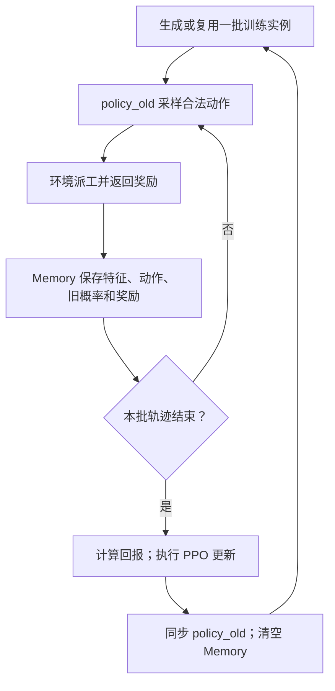

# PPO：轨迹采集与策略更新

> 2026-10-21｜代码依据：`train.py` 与 `PPO_model.py`。此前 DQN 经验回放属于另一条讨论路线，本篇记录上传项目的实际逻辑。

## 1. 一批数据怎样用于训练？

`Memory` 虽被注释为“经验回放缓冲区”，实际流程是**采集一批轨迹，更新若干轮，然后清空**。不能直接按 DQN 的长期经验池理解。

## 2. 回报、优势与概率比分别做什么？

$$
G_t=\sum_{u=t}^{T-1}\gamma^{u-t}r_u,\qquad
A_t=\widetilde G_t-V_\theta(s_t)
$$

$G_t$ 为后续累计回报；$\widetilde G_t$ 是代码按每个环境的轨迹标准化后的回报。Critic 预测 $V_\theta(s_t)$，优势 $A_t$ 比较实际回报与当前价值估计。计算策略梯度时，优势中的价值估计停止梯度；这里没有使用 GAE。

$$
\rho_t=\frac{\pi_\theta(a_t\mid s_t)}
{\pi_{\mathrm{old}}(a_t\mid s_t)},\qquad
L_{\mathrm{clip}}=
\mathbb E_t\!\left[
\min\left(\rho_tA_t,\,
\operatorname{clip}(\rho_t,1-\epsilon,1+\epsilon)A_t\right)
\right]
$$

概率比比较同一个已采集动作在新旧策略下的概率。裁剪项限制过大的策略变化；它不是对参数变化或 KL 距离的严格上界。代码最小化负的裁剪目标，并加上价值误差、减去熵奖励；此处只保留策略更新的核心式。

## 3. 当前配置与后续扩展如何区分？

| 配置项 | 上传文件中的值 | 含义 |
|---|---:|---|
| `batch_size` | 20 | 并行训练环境数 |
| `update_timestep` | 1 | 每完成一批调度后更新 |
| `K_epochs` | 3 | 同批数据的更新轮数 |
| `eps_clip` | 0.2 | 裁剪范围参数 |
| `parallel_iter` | 20 | 每 20 次迭代重新生成训练实例 |
| `gamma` | 1.0 | 不折扣累计奖励 |

**扩展边界：** 若加入偏好，采集与更新必须保持其对应关系。不能直接把旧轨迹换成任意偏好：动作由采集时的策略产生，PPO 概率比也依赖该行为策略。跨偏好复用需要额外论证。

**进度：** 已追踪“采集—更新—同步—清空”的调用链；本次未执行训练，配置值不代表已经完成的实验。
