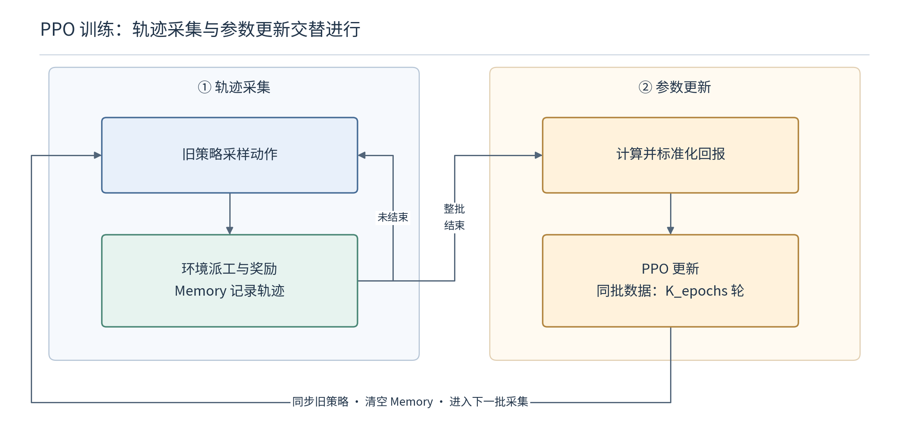
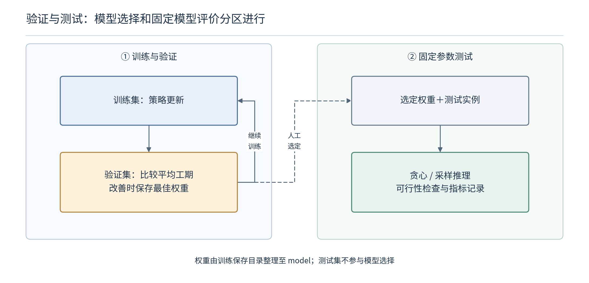

# 代码阅读（二）：轨迹怎样训练策略，模型又怎样被验证

> 主线：旧策略采集完整轨迹，Memory 保存当时的计算条件，当前策略重新计算概率并优化，验证集选择检查点，测试集评价固定模型。重点区分数据流、梯度流和结果口径。

## 1. 为什么需要两个策略对象，而不是边派工边直接改参数？

`PPO.__init__` 创建 `policy` 和 `policy_old`，初始参数一致。采集使用旧策略，优化器更新当前策略，更新完成再同步。这样一批轨迹有清楚的行为策略参照，能够计算 PPO 的新旧概率比。

**直觉：** 先保存一版稳定的派工规则，用它完成这批任务并留下记录；再根据记录修改规则。若采集过程中不断改规则，却没有保存每条样本对应的旧概率，就容易丢失“这条数据究竟怎样产生”的参照。

`train.main` 还创建训练环境、固定验证环境与 Memory。当前配置有几个不同的“批”和“轮”：

| 参数 | 当前值 | 具体控制什么 |
|---|---:|---|
| `batch_size` | 20 | 同时派工的训练实例数 |
| `parallel_iter` | 20 | 第 1、21、41…次外层迭代重新生成实例 |
| `update_timestep` | 1 | 每完成一批调度就执行一次更新 |
| `K_epochs` | 3 | 同一批轨迹在更新阶段使用三轮 |
| `minibatch_size` | 512 | 一次梯度计算包含多少个决策样本 |
| `save_timestep` | 10 | 每十次外层迭代运行验证 |
| `max_iterations` | 1000 | 外层完成多少批调度 |

**代入算账：** 假设某批每个实例有五十道工序，则二十个实例一共提供一千个决策样本。按五百一十二拆分，一轮更新处理五百一十二和四百八十八两批，三轮通常有六次优化器更新。五十是教学假设，真实工序数由实例生成决定。

**边界辨析：** 二十个环境不是二十个时间步；三轮优化不是三批新轨迹；复用同一批实例二十次外层调度，也不等于复用之前已清空的旧轨迹。源码会用更新后的策略重新派工。

## 2. Memory 为什么保存图与特征，而不是只保存嵌入？

### 2.1 环境在变化，历史状态需要真正留下来

采集时在 `torch.no_grad()` 中调用 `policy_old.act`，随后 `env.step` 原地修改图与状态。如果 Memory 只指向这些可变对象，下一步可能把上一步的记录也改掉，因此源码保存深拷贝。

保存内容包括邻接矩阵、标准化特征、加工边特征、候选索引、合法动作掩码、动作索引、旧动作对数概率、奖励和终止标志。**直觉：** 不只是保存“当时选了谁”，还要保存当时的预约表和候选清单，才能在更新时重新评价这个历史选择。

| 保存项 | 更新时用来回答什么 |
|---|---|
| 图与标准化特征 | 当前参数如何重新理解当时状态？ |
| 候选索引与掩码 | 当时哪些组合参与了概率分配？ |
| 已采集动作 | 要重新评价哪一项选择？ |
| 旧对数概率 | 采集时这项选择的概率是多少？ |
| 奖励与终止标志 | 后续回报怎样累加、在哪里结束？ |

名为 `raw_opes`、`raw_mas` 的 Memory 项实际写入的是标准化后的特征。变量名保留了旧叫法，不能因此再重复标准化。

### 2.2 为什么更新时要重新跑 HGNN？

采集时关闭了梯度，旧参数生成的嵌入也不能代表当前参数。`evaluate` 根据保存的数据重新计算 HGNN、Actor 和 Critic，才能让损失对当前网络反向传播。

若只固定保存旧嵌入再训练评分头，就相当于不通过这批数据更新图编码器，训练的已经是另一种方案。当前源码的 Actor 和 Critic 都依赖共享 HGNN，因此总损失也会训练图编码器。

**维度锚点：** 五十步、二十个环境的工序特征列表，堆叠后形状可为 $50\times20\times N\times6$；交换环境维和时间维，再展平前两维，得到 $1000\times N\times6$。图、掩码、动作和旧概率必须使用对应的展平顺序。

**边界辨析：** Memory 在一次更新后清空，是当前 PPO 的批轨迹缓冲；不是 DQN 的长期经验池。加入跨批精英轨迹之前，需要重新处理行为策略与当前策略的分布差异。

## 3. 奖励怎样变成更新目标，为什么要停止部分梯度？

### 3.1 从后往前累加，再在每个环境内标准化

`update` 遇到终止标志时重置累计量，向前递推：

$$
G_t=r_t+\gamma G_{t+1}.
$$

$G_t$ 包含当前奖励与折扣后的未来回报。**直觉：** 最后一项账单先确定，再把后续账单往前结转；不能把两个独立 episode 的账单串成一份。

随后代码按每个环境的轨迹计算均值和标准差：

$$
\widetilde G_t=\frac{G_t-\mu_G}{\sigma_G+10^{-5}}.
$$

$\mu_G,\sigma_G$ 是该环境本批轨迹回报的统计量，微小常数用于缓解零标准差的除法问题。**直觉：** 先把这份任务中哪些步骤相对更好、哪些更差转换到便于优化的尺度。

**代入推演：** 三步奖励为 $(-1,-1,-2)$、折扣为一，回报为 $(-4,-3,-2)$。均值为负三；按默认样本标准差计算为一，因此标准化后约为 $(-1,0,1)$。

最后一步的原始回报仍为负二，标准化后却为正一。它表示在这条轨迹的数值分布中高于均值，不表示生产获得了一个单位的实际利润。

**边界辨析：** 原始奖励、标准化回报、最终工期单位不同。多目标扩展时，逐轨迹缩放还会改变不同实例与偏好样本的相对训练尺度，需要单独评价。

### 3.2 对数概率为什么能恢复概率比？

$$
\rho_t=\exp(\ell_t-\ell_t^{\mathrm{old}}),\qquad
\ell_t=\log\pi_\theta(a_t\mid s_t).
$$

旧对数概率来自采集记录，当前对数概率来自 `evaluate`。**直觉：** 比较历史动作时只需查同一项的两份概率记录，不需要给它换成当前重新采样的动作。

**代入：** 新旧概率为 $0.3$ 与 $0.2$，对数差约为 $-1.2040-(-1.6094)=0.4054$；指数还原约为 $1.5$，与直接相除一致。

代码进一步使用

$$
A_t=\widetilde G_t-\mathrm{stopgrad}(V_\theta(s_t)).
$$

`stopgrad` 对应 `detach`。Critic 的值作为策略更新的比较基准；Critic 自身依靠价值损失学习。**直觉：** 评价者给出基准后，Actor 应改善自己的选择，而不能通过修改基准来让同一选择看起来更好。

例如回报为负五，价值预测为负八，优势为三。如果仅把价值预测改成负十，优势会变成五，但动作概率和真实调度完全没改。停止这条梯度路径，避免 Actor 项把降低价值预测当成改善策略的捷径。

### 3.3 三项总损失分别把网络推向哪里？

$$
\mathcal L=-L_{\mathrm{clip}}
+0.5\,\mathbb E_t[(V_\theta(s_t)-\widetilde G_t)^2]
-0.01\,\mathbb E_t[H(\pi_\theta)].
$$

这里采用当前配置系数。第一项取负号，是因为代码做梯度下降，而 PPO 原目标要最大化；第二项训练 Critic；第三项鼓励保留一定动作探索。

**数值直觉：** 价值误差从二降为一，平方误差从四降为一，对这一项的加权损失减少一点五；策略目标和熵若同时变化，总损失不一定按相同幅度下降。总损失是多个训练要求的组合，不能直接当成工期。

更新时依次执行 `zero_grad`、`backward`、`optimizer.step`，完成三轮后复制当前策略参数给旧策略。`train.py` 清空 Memory，开始下一批采集。

**变体辨析：** 上传实现是标准化折扣回报减当前价值，未实现 GAE 递推；PPO 目标使用裁剪，不能因论文或同组稿件写了 KL 惩罚，就把它描述为 PPO＋KL。

## 4. 为什么验证与测试需要使用不同数据和结果口径？

### 4.1 验证集回答“现在该保留哪一版参数”

`get_validate_env` 加载 `data_dev`，当前为一百个验证实例。每十次外层迭代，`validate` 用贪心动作调度，返回各实例工期与平均值。平均工期更好才保存检查点；当前仅保留一份最佳权重。

**数值例子：** 三次验证均值为一百二十、一百一十五、一百一十八，应保留第二次参数，而非最后一次。这里比较的是固定验证任务上的调度结果，不是训练损失最低的时刻。

训练保存到 `save/train_时间戳`，测试读取 `model`。需要明确实际选用了哪个文件，二者没有自动沿同一路径衔接。

**边界辨析：** 若反复观察测试结果来挑选参数，测试集就承担了验证作用，不能再把最终分数当成独立评价。

### 4.2 贪心和采样，为什么不能只比较最小工期？

| 模式 | 当前逻辑 | 预算含义 |
|---|---|---|
| DRL-G | 每步取最大概率；重复十次取均值 | 主要检查固定规则和计时，确定性时安排不变 |
| DRL-S | 同一实例复制一百份，逐步采样 | 从一百个候选中取最小工期 |

**极简推演：** 一个模型单次得到工期一百一十；另一个模式生成候选 $110,108,114$，报告最好值一百零八。改善可能来自搜索预算，不能仅凭这两个数判定网络结构更好。应同时报告候选数与耗时。

`schedule` 返回的计时覆盖派工循环，后续 `validate_gantt`、前面的模型加载和环境构建并未全部包含。与师兄稿件“包括指标计算的总耗时”比较前，应先对齐定义。

**边界辨析：** 重复解码不是独立训练种子；多次推理的稳定性与多次训练的稳定性是不同问题。可行性检查失败也不能继续当作正常低工期样本统计。

## 5. 当前快照有哪些会影响复现的具体障碍？

| 位置 | 已观察到的实现 | 需要核对的后果 |
|---|---|---|
| `load_fjs` | 两轮扫描没有排除文件头 | 先修解析入口，再验证小实例 |
| 随机种子 | 定义 `setup_seed`，但入口未调用 | 定义函数不等于实验已固定种子 |
| mini-batch 循环 | 固定执行完整批数加一轮 | 恰好整除时可能传入空切片 |
| `test.main` | 判定设备前初始化 NVML | CPU 或非 NVIDIA 环境仍可能先失败 |
| Excel writer | 关闭后，后续再次使用同一对象 | 需要结合实际依赖版本统一处理生命周期 |
| 测试权重 | 结果规则列表与文件列表分开构建 | 列名与实际加载权重可能错位 |
| 可行性检查 | 失败时打印提示后继续 | 实验记录应显式拒绝或单列非法安排 |

默认输出表头还按一千次迭代、一百个验证实例写定，改变配置后需要同步检查。

**本次理解：** 一条训练记录必须同时对得上当时状态、动作和旧概率；一次性能结论还必须对得上验证选择、测试权重与计算预算。

**依据与进度：** 上传 `train.py`、`PPO_model.py::{Memory,PPO.update,HGNNScheduler.evaluate}`、`validate.py`、`test.py` 与 `config.json`。已完成静态阅读，尚未完整训练或测试；本篇计算例子均为推演。
