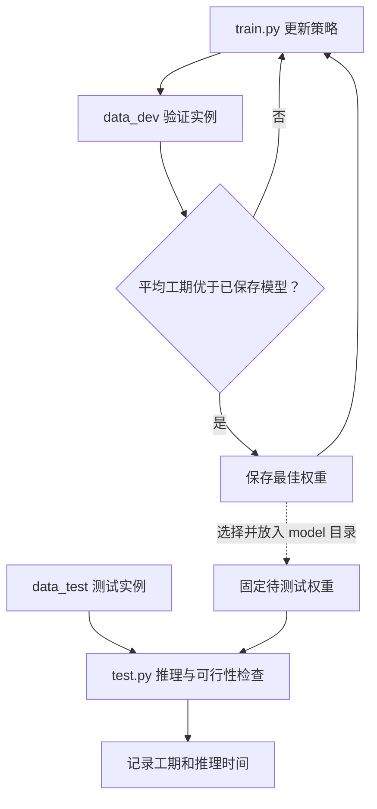

# 验证与测试：模型选择和推理方式

> 2026-10-21｜代码依据：`train.py`、`validate.py`、`test.py`。关注评价逻辑，不将代码附带文件视为本次实验结果。

## 1. 验证与测试各自决定什么？

验证集平均工期用于选择权重：

$$
\overline C_{\mathrm{val}}
=\frac{1}{N_{\mathrm{val}}}
\sum_{i=1}^{N_{\mathrm{val}}}C_{\max}^{(i)}
$$

当前配置每 10 次训练迭代验证一次，`valid_batch_size=100`。训练代码将最佳权重存入 `save/train_时间戳`；测试代码从 `model` 读取权重。两者不是自动衔接的同一路径。

## 2. 贪心测试与采样测试是否可以直接比较？

| 模式 | 动作选择 | 结果口径 | 计算预算 |
|---|---|---|---|
| DRL-G | 选择概率最大动作 | 单条贪心调度；代码可重复运行并取均值 | 当前配置重复 10 次，主要还用于计时 |
| DRL-S | 按策略概率采样 | 同一实例生成多个候选，取最小工期 | 当前配置采样数为 100，仅开启采样时生效 |

$$
a_t^{G}=\arg\max_{a\in\mathcal A(s_t)}\pi_\theta(a\mid s_t),
\qquad
C_{\max}^{S}=\min_{1\le k\le K}C_{\max}^{(k)}
$$

当前 `sample=false`，采用 DRL-G。DRL-S 的最好值来自更多次搜索，比较时必须同时报告采样数和耗时。多次贪心推理也不等于多个随机种子独立训练。

## 3. 多目标扩展后，还需检查什么？

| 当前代码已包含 | 多目标扩展后需要加入 |
|---|---|
| 工期、推理时间 | 能耗等实际目标分量 |
| `validate_gantt` 可行性检查 | 各偏好下均保持可行 |
| 固定模型推理 | 同一实例重置后遍历偏好 |
| 单目标最好值 | 去重与候选非支配筛选 |

**评价原则：** 损失下降不能替代实际调度指标；测试集不参与反复选参。验证与测试中的可行性检查失败会输出提示，但不会自动保证不保存结果，因此记录实验时仍需排除非法安排。

**进度：** 已核对数据目录、权重路径与两种推理模式；尚未执行测试或报告改善比例。
