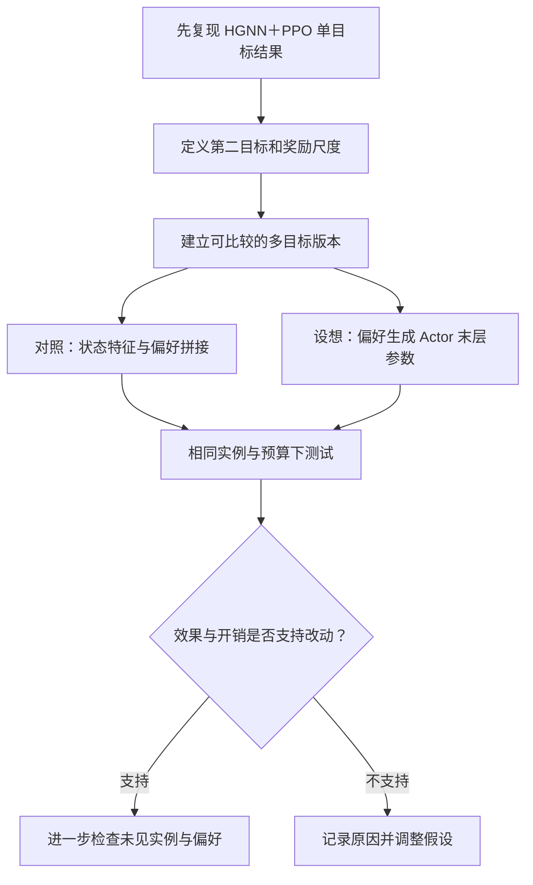

# 创新思路：从偏好输入到部分参数生成

> 2026-10-21｜本篇是结合上传代码形成的待验证设想，尚未实施，也未完成新颖性检索。

## 1. 基于现有 PPO，先改动哪一部分？

优先比较两种表达偏好的方式：直接输入偏好，以及让偏好改变网络参数。先有简单对照，才能判断超网络是否带来额外收益。

## 2. 部分参数生成可以怎样表达？

以共享 HGNN 表示 $h(s)$ 和待生成的 Actor 末层为例：

$$
\theta_p=g_\phi(p),\qquad
\pi_{\phi,\psi}(a\mid s,p)
=\operatorname{MaskedSoftmax}_a
\left(f_{\theta_p}(h_\psi(s))\right)
$$

$\psi$ 表示共享特征部分参数，$f_{\theta_p}$ 表示带生成参数的动作评分模块。实际候选还包含工序和机器局部信息。该式说明信息依赖，不代表代码已实现。

| 待验证问题 | 初步改动 | 应观察什么 |
|---|---|---|
| 不同偏好生成相似安排 | 调整偏好覆盖，加入端点与中间区域 | 各区域目标表现、重复方案比例 |
| 全参数生成代价较大 | 先生成 Actor 最后一层的 65 个参数 | 总参数量、训练耗时、测试质量 |
| 第二目标反馈难以学习 | 设计与最终目标一致的增量奖励 | 累计奖励与终局指标是否对应 |

**与原设想的修正：** 上传代码已经使用工期增量奖励，因此“从终局奖励改为逐步奖励”不能作为该项目新增的改进点。需要研究的是新目标如何提供一致反馈。

## 3. 什么证据能支持继续推进？

| 阶段 | 完成依据 | 本次状态 |
|---|---|---|
| 代码理解 | 能定位状态、奖励、更新与测试入口 | 已静态核对主要调用 |
| 原模型复现 | 可行调度、验证曲线与测试记录 | 本次未运行 |
| 多目标基础版本 | 目标计算一致、偏好输入有效 | 待设计 |
| 超网络改动 | 与偏好拼接等对照比较 | 设想阶段 |

PPO 扩展还需处理两点：Critic 如何接收偏好，以及旧策略快照如何覆盖新加入的共享参数和超网络。不能仅替换 Actor 后就沿用未经核对的训练逻辑。

**下一步：** 先完成原项目的小规模运行记录，再选择一个改动做对照。保留成功和失败案例，依据数据推进，不预写“优于原方法”的结论。
