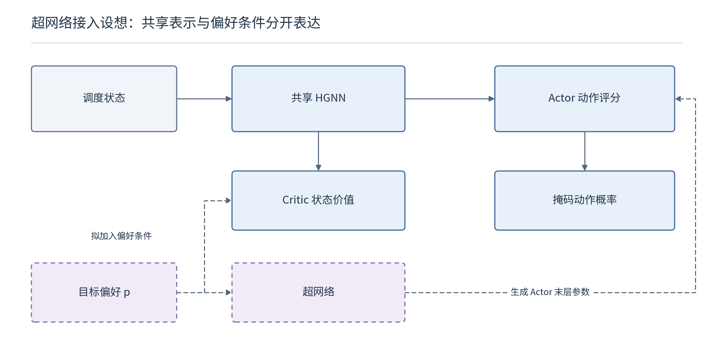

# 超网络的意义：学会调节哪部分参数，为什么可能有用

> 2026-10-21。本篇是在已有超网络和偏好条件研究基础上的理解与推导。末层生成已有直接文献，以下首先讨论机制和边界，不把基本结构当作新方法。

## 1. 偏好怎样通过生成参数影响策略？

普通策略用一组参数 $\theta$ 把状态映射为动作概率。偏好拼接将 $\mathbf w$ 与状态一起输入固定参数网络；超网络则先根据条件生成部分参数，再用它们计算动作分数。

$$
\theta_{\mathbf w}=g_\phi(\mathbf w),\qquad
z_a=f_{\theta_{\mathbf w}}(h_\psi(s,a)),\qquad
\pi(a\mid s,\mathbf w)=\frac{\exp(z_a)}{\sum_{b\in\mathcal A(s)}\exp(z_b)}.
$$

$\phi$ 是超网络自身的可训练参数；$\psi$ 是共享表示部分的参数；$\theta_{\mathbf w}$ 是生成结果。生成参数参与当前前向计算，并不意味着每个新偏好都要重新训练一个独立模型。

蓝色表示现有结构，紫色虚线表示拟接入部分。图中的末层生成是一种基础实现；已有文献采用了相近思路，它的价值在于便于研究“参数怎样受条件影响”。

以两维隐藏特征作纯数学示例：候选 A 的特征为 $(1,0)$，B 为 $(0,1)$。若一种偏好生成评分权重 $(2,0)$，则 A 分数更高；另一偏好生成 $(0,2)$，则 B 分数更高。这两个隐藏特征并不天然对应工期和能耗，其调度含义仍需通过训练形成。

## 2. 为什么考虑只生成一部分参数？

上传 Actor 的结构为 $32\to64\to64\to1$。带偏置的全连接层从 $d_{\mathrm{in}}$ 到 $d_{\mathrm{out}}$，参数数量为

$$
N=d_{\mathrm{in}}d_{\mathrm{out}}+d_{\mathrm{out}}.
$$

因此整个 Actor 为

$$
(32\times64+64)+(64\times64+64)+(64\times1+1)=6337.
$$

只生成末层时，名义输出维度为 $64+1=65$。生成向量的长度、超网络自身参数量和训练系统总参数量，需要分别计算。

举例，若针对三目标偏好使用一个教学性的 $3\to32\to65$ 超网络，它自身有

$$
(3\times32+32)+(32\times65+65)=2273
$$

个参数。共享 HGNN 和 Actor 前层还存在，Critic 也可能需要改动。因此，从“生成 65 个数”不能推导出“新增成本只有 65 个参数”。

共享表示和参数生成的价值，应放在需要服务多种偏好的场景中评价。相比为 $K$ 个偏好分别存储完整网络，它们可能减少重复存储、重复训练和模型管理；若只使用一组固定权重，额外生成网络未必值得。

## 3. 为什么共同偏置不改变当前动作概率？

假设所有候选共用同一末层，输出为

$$
z_a=\mathbf v(\mathbf w)^\top h_a+b(\mathbf w).
$$

在同一状态与偏好下，所有合法候选都加上相同标量偏置。因此

$$
\frac{e^{\mathbf v^\top h_a+b}}{\sum_{c\in\mathcal A(s)}e^{\mathbf v^\top h_c+b}}
=\frac{e^{\mathbf v^\top h_a}}{\sum_{c\in\mathcal A(s)}e^{\mathbf v^\top h_c}}.
$$

共同偏置在分子、分母中抵消。因此，在“共享标量评分器＋直接 softmax”这一结构的 65 个末层参数中，共同偏置不影响动作概率；只生成这个偏置也无法实现偏好适应。

这个结论只针对当前输出结构。候选特有的偏置、后接额外非线性或用于其他输出的偏置，仍可能起作用。

还要区分“改变温度”和“改变排序”：若生成的权重始终只是 $\mathbf v(\mathbf w)=c(\mathbf w)\mathbf v_0$，且 $c\gt 0$，那么贪心动作排序不变，只改变概率的尖锐程度。采样结果可能变化，却不一定学到了真正不同的贪心调度取舍。

后续除了比较不同偏好生成的参数，还应追踪有效权重方向、动作排序，以及最终目标是否随偏好合理变化。

## 4. 超网络怎样获得训练信号？

PPO 损失通过动作概率传回评分器，再通过生成参数传回超网络。用链式法则的结构表达为

$$
\frac{\partial\mathcal L}{\partial\phi}
=\frac{\partial\mathcal L}{\partial\theta_{\mathbf w}}
\frac{\partial g_\phi(\mathbf w)}{\partial\phi}.
$$

不需要环境对离散派工动作可微；策略梯度根据动作的对数概率与优势提供训练信号。需要保持可微的是“超网络输出—动作评分—概率—损失”这一条网络计算链。

实现时，如果把生成张量用 `.data` 复制进另一个独立参数，或在当前策略更新中把它提前 `detach`，可能切断这条链。采集旧策略时可以不求梯度，但更新当前策略时必须重新生成与当前参数对应的权重。

旧策略快照也必须覆盖新加入的超网络与共享层。只保存生成后的某一个末层，却让共享 HGNN 继续变化，就不是一份完整的旧行为策略。每条轨迹还应保留原偏好与必要的场景条件。

## 5. 研究意义应当用什么证据支撑？

| 可能的价值 | 需要观察的证据 | 不能直接作出的推断 |
|---|---|---|
| 一次训练服务多种取舍 | 未见偏好下的目标质量、解集覆盖与总训练成本 | 可输入任意实数权重就等于适应任意偏好 |
| 部分参数适应、其余共享 | 与同预算拼接、FiLM 等对照的质量和开销 | 生成参数少就必然更快、更稳定 |
| 条件变化时形成不同决策规律 | 受控条件实验中的动作、参数与目标变化 | 参数不同就意味着方案有意义地不同 |
| 降低多模型维护成本 | 相同偏好数量下的模型存储与部署成本 | 比一个固定权重小模型也一定更省 |

我目前更倾向于用“共享与适应的分工”理解超网络：复用通用的工序—机器关系知识，让条件生成负责随偏好或场景变化的部分。这仍是一种建模选择，没有普遍优于充分表达的普通条件网络的保证。

连续的参数映射不会自动产生连续且完整的帕累托前沿。调度动作是离散的，贪心选择可能突然切换，不同偏好也可能对应同一安排。因此，仍需通过可行安排的质量、覆盖和计算预算评价研究价值。

依据与推导范围： 超网络概念参考 Ha 等（2016）；偏好条件组合优化参考 Lin 等（2022）；末层调度条件化已有 Liu、Han（2026）直接工作。上述参数计数、共同偏置抵消和正比例缩放分析，均为针对当前 Actor 结构的本笔记推导。
