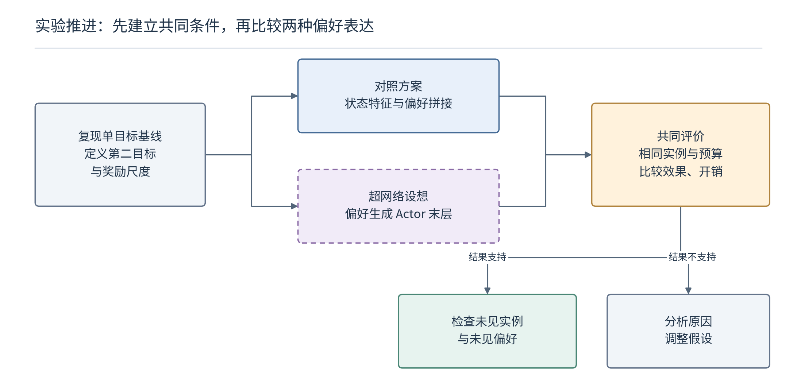

# 怎样验证超网络是否带来实际收益

> 2026-10-21。本篇记录下一步实验应回答的问题与训练、测试逻辑。属于待执行设计，不是已完成实验报告。先以现有联合动作 PPO 为基础，不把师兄的分层实现混入同一个基线。

## 1. 先建立可以解释的多目标基础版本

当前原代码只优化工期。第一步应先修正读取等运行障碍，完成小实例检查、单目标训练与固定测试，记录实际环境版本、配置、随机种子和权重来源。

随后可以先研究工期与总拖期两个目标。这样能够利用师兄稿件中的交期问题，又不必一开始同时实现能耗积分、主动等待和分层策略。交期必须在实例生成时确定，并作为环境输入；不能用测试安排的最终完成时间反过来生成交期。

假设使用按训练或验证数据预先确定的尺度 $s_C,s_T\gt 0$：

$$
\widetilde C=C_{\max}/s_C,\qquad
\widetilde T=T_{\mathrm{tardy}}/s_T,\qquad
J_{\mathbf w}=w_1\widetilde C+w_2\widetilde T.
$$

可以研究与终局目标一致的增量奖励。先定义中间目标估计 $\widehat{\mathbf F}(s)$，保证终态恢复实际指标，再使用

$$
r_t=\mathbf w^{\top}
\left(\widehat{\mathbf F}(s_t)-\widehat{\mathbf F}(s_{t+1})\right).
$$

当偏好在整条轨迹固定、$\gamma=1$ 时，累计奖励等于初始估计加权值减去终局加权值。初始项对同一实例和偏好固定，所以这提供清楚的目标对应关系。中间估计可以不精确，但必须一致使用；估计噪声仍可能影响学习难度。

总拖期的中间估计可由工件完成时间估计与交期计算，但不能把尚未完成的预测当成已发生拖期。先用两三个可手算安排检验奖励相消和终态指标，再决定是否采用更复杂的局部引导。

## 2. 基础对照需要回答什么？

图中的偏好拼接与末层生成是基础对照，都属于已有方法范畴。真正检验新的条件适应假设时，还要加入使用相同场景信息的对照。

| 版本 | 偏好／场景如何进入模型 | 对照目的 |
|---|---|---|
| 固定权重策略 | 固定一组权重训练 | 作为某个取舍下的参照，不用于宣称覆盖整个前沿 |
| 偏好拼接 | 把偏好拼到候选特征或评分头输入 | 检查普通条件网络是否已经足够 |
| 特征调制 | 用偏好控制 FiLM 等特征变换 | 检查是否必须生成评分权重 |
| 偏好生成末层 | 超网络根据偏好生成有效评分权重 | 建立参数生成的基础版本 |
| 偏好＋场景拼接 | 普通网络同时看到两类条件 | 排除“只是增加信息”的解释 |
| 偏好＋场景生成 | 根据相同条件生成权重或受限残差 | 检验联合条件适应的假设 |

不同条件化方式的额外参数量可能不同，应报告实际总参数、训练时间和推理时间，并增加容量相近的对照。只把较大网络与较小网络比较，不能把收益全部归因于生成机制。

若与 PGRL、DPG-GRL 等已发表方法比较，还需取得其实现，核对目标、动作空间、数据与预算。当前可以把它们列为近邻与后续基线，但不能在结果表里填入未经统一协议重跑的数字。

## 3. 一条偏好条件轨迹怎样用于训练？

每条轨迹开始时抽取实例和偏好，整个调度过程保持该偏好固定。若加入静态实例条件，也在此时计算，并与轨迹绑定。旧策略使用这些条件采样动作，Memory 保存图、动作、旧对数概率、偏好、条件、目标分量奖励和终止信息。

更新时，当前策略在原来的状态和条件下重新计算动作概率；Critic 至少接收偏好，若场景信息参与策略，也应检查价值网络的输入是否足以表达对应价值。

$$
\rho_t=\exp\left(
\log\pi_{\mathrm{new}}(a_t\mid s_t,\mathbf w,c_I)
-\log\pi_{\mathrm{old}}(a_t\mid s_t,\mathbf w,c_I)
\right).
$$

图编码器、共享评分层、超网络共同组成当前策略。一次更新完成后同步完整旧策略，清空本批轨迹，再采集下一批。不要为了增加数据量，直接把同一批轨迹随意重标成多个偏好。

若参数仅依赖静态偏好和实例条件，采集时可以每条轨迹生成一次后复用；但当前策略优化中参数会变化，不能跨优化步骤继续使用旧生成结果。若以后引入实时状态作为生成条件，生成频率与缓存策略还需要重新设计。

## 4. 未见偏好与未见实例要分开测试

一个便于检查的二目标试验设计是：训练先使用 11 个固定偏好点，$w_1\in\{0,0.1,\ldots,1\}$；额外保留 $\{0.05,0.15,\ldots,0.95\}$ 作为未训练偏好点。这样“未见偏好”有清楚的定义，不会和训练时连续采样的覆盖混在一起。

验证与测试使用不同实例。验证阶段选择超参数和检查点，测试集留到配置确定后使用。至少分别记录四种组合：

| 实例分布 | 已训练偏好 | 未训练偏好 |
|---|---|---|
| 与训练相同分布的新实例 | 基本泛化 | 偏好插值能力 |
| 预先定义的变化分布 | 场景适应能力 | 场景变化与偏好变化同时发生时的表现 |

变化分布可以先只选择一个因素，例如降低平均可选机器比例，或提高交期紧迫程度。改动工件数、机器数、加工时长和交期四个因素之后只报告一个均值，很难解释模型在哪里有效。

初步实验可先用少量种子检查实现与趋势，正式比较建议至少保留多个独立训练种子，例如 5 个。重复解码主要反映求解随机性，不能替代重复训练对稳定性的检查。

## 5. 结果不只看一个加权目标

对每个测试实例，固定偏好列表与每个偏好的采样数，生成可行候选，再去重、做非支配筛选。这个流程应对所有方法使用相同预算。贪心推理、采样搜索、模型加载和指标计算分别计时，再说明报告了哪些部分。

| 记录项 | 解释什么问题 |
|---|---|
| 各偏好下的原始目标与标量目标 | 模型是否按当前偏好作出合适取舍 |
| 非支配候选与 HV | 该实例上得到的目标覆盖是否改善 |
| 相对经验参考集的距离 | 与共同参考候选相比，还有哪些区域遗漏 |
| 重复方案比例、偏好区间质量 | 是否出现忽略偏好的退化；重复本身不自动等于失败 |
| 总参数、训练成本、完整推理时间 | 改善是否以过大的计算成本换来 |
| 约束检查失败率 | 输出质量是否建立在可行安排之上 |

HV 的参考点、目标尺度和截取规则必须一致，并在比较前确定。可依据验证数据制定参考点，再冻结用于测试，同时记录超出参考范围的情况。不同实例不应混成一个前沿，不同单位或不同参考点的 HV 也不能直接比较。

若真实帕累托前沿未知，可以由多个方法及较强搜索所得候选构建共同经验参考集，明确它不是全局真前沿。距离变小只能说明更接近这个参照，不能替代最优性证明。

## 6. 怎样解释最后可能出现的三种结果？

若联合条件生成在预先定义的变化分布上有稳定优势，而同信息拼接和特征调制没有达到相同效果，可以进一步研究生成权重与瓶颈结构的关系，并扩大基线与数据覆盖。

若优势只出现在训练分布、换一个随机种子就消失，应优先检查容量、偏好覆盖、回报尺度和训练方差，不急于追加模块。

若没有明显优势，仍能得到有用结论：对当前状态表示和任务规模，普通条件网络可能已经足够，超网络增加的复杂度没有形成收益。此时应保留负面结果，重新选择问题，而不是改用更有利的测试集。

**本次推进到的位置：** 已完成原理梳理、上传代码阅读、两篇论文对照与近邻文献检索；解析入口做了隔离检查。完整基线复现、多目标环境、超网络训练和上述测试均尚未执行。
